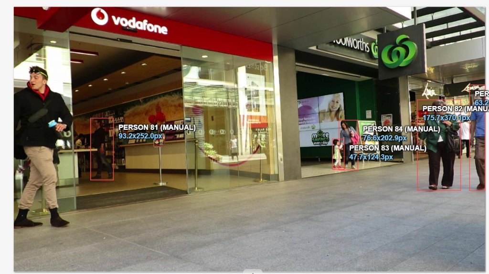
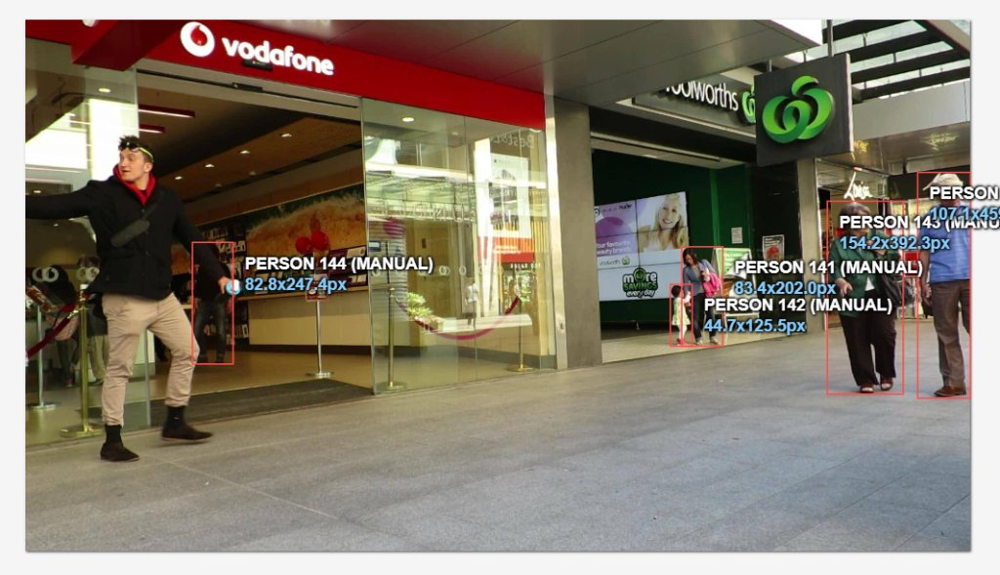
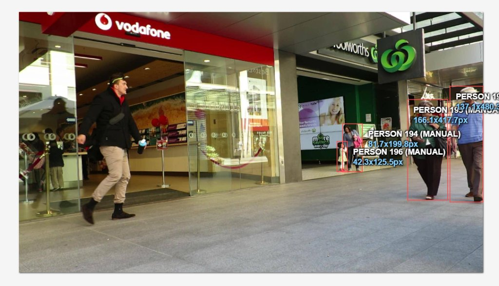

# Báo cáo cá nhân — Phạm Đức Mạnh - 2A202603079

Đoạn video: MOT17-09, 150 frame (frame 1–150), nguồn MOTChallenge, giấy phép CC BY-NC-SA 3.0.

## 0. Thông tin học viên

- Họ tên: Phạm Đức Mạnh
- MSSV: 2A202603079
- Mã đề (A/B/C): B
- Email: manh.pd2026@gmail.com
- Link repository: https://github.com/Payjack123/K5-L2-DAY05-PhamDucManh-2A202603079-MOTTracking
- Giờ bắt đầu: 16:40 13/11/2026
- Giờ kết thúc: 23:15 13/11/2026

## 1. Xem trước đoạn video (CP0)

Ghi **trước khi vẽ**, mỗi người một dòng.

| Mã | Frame xuất hiện | Frame cuối thấy được | Rẽ / dừng / đổi tốc độ ở frame | Bị che ở frame | Ghi chú |
|---|---|---|---|---|---|
| P1 | 0 | 149 | 30, 80 | 41–48 | Đi bên trong shop Vodafone, bị người đi bên ngoài che |
| P2 | 0 | 127 | 40, 70 | 57–70 | Người đi bộ ở vỉa hè bên phải đi sang trái |
| P3 | 39 | 70 | 50 | Không | Xuất hiện từ mép phải ở Frame 39 |
| P4 | 0 | 146 | 60, 100 | 110–135 | Bé gái áo sáng màu đi trước mẹ |
| P5 | 0 | 149 | 40, 90 | 0–60 | Người mẹ dắt tay bé gái, phần thân dưới bị bé gái che |

## 2. Keyframe và thời gian (CP1, CP4)

Số keyframe lấy từ kết quả `src/check_submission.py`.

| Mã | Số keyframe | Keyframe ở frame | Số frame có mặt | Keyframe / 100 frame | Thời gian (phút) | Chỗ khó |
|---|---|---|---|---|---|---|
| P1 | 16 | 0, 10, 20, 30, 40, 50, 60, 70, 80, 90, 100, 110, 120, 130, 140, 149 | 142 | 11.3 | 25 | Bị che khuất qua cửa kính shop Vodafone |
| P2 | 10 | 0, 10, 20, 30, 40, 50, 80, 100, 110, 127 | 110 | 9.1 | 20 | Đi qua vùng đám đông phức tạp |
| P3 | 5 | 39, 40, 50, 60, 70 | 32 | 15.6 | 10 | Mới bước vào từ mép phải khung hình |
| P4 | 13 | 0, 10, 20, 30, 40, 50, 60, 70, 80, 90, 100, 140, 146 | 121 | 10.7 | 20 | Kích thước nhỏ, đi sát cạnh người lớn |
| P5 | 16 | 0, 10, 20, 30, 40, 50, 60, 70, 80, 90, 100, 110, 120, 130, 140, 149 | 150 | 10.7 | 25 | Che khuất một phần thân dưới bởi bé gái |
| **Tổng** | 60 | | 555 | 10.8 | 100 | |

Keyframe / 100 frame của cả bài = tổng keyframe ÷ tổng số frame có mặt × 100 = 60 ÷ 555 × 100 = 10.8 keyframe / 100 frame.

Bạn đặt keyframe nhiều nhất ở người nào? Vì sao (người đó rẽ, dừng, lại gần camera hay bị che)?

Đặt keyframe nhiều nhất ở người P1 và P5 (16 keyframe mỗi người). Lý do: P1 di chuyển qua đoạn bị che khuất và phản chiếu phức tạp qua cửa kính Vodafone, cần nhiều keyframe ở trước và sau đoạn che để nắn hướng nội suy; còn P5 đi cùng và dắt tay bé gái P4, có nhiều đoạn thay đổi sải bước và bị che một phần thân dưới nên cần đặt keyframe đều đặn để giữ độ khít của hộp bao amodal.

## 3. Đoạn bị che (CP2)

Người bị che: `P1`

| Mốc | Frame |
|---|---:|
| Bắt đầu bị che một phần (bật `occluded`) | 29 |
| Mất hẳn (bật `outside`) | 41 |
| Hiện lại (tắt `outside`) | 49 |
| Thấy rõ trở lại (tắt `occluded`) | 60 |

- Thời gian khuất hẳn: 8 frame = 0.27 giây.
- Quyết định: giữ cùng ID.
- Lý do (trả lời 3 câu: khuất bao lâu so với 60 frame, ngoại hình có khớp, chỗ hiện lại có đúng hướng và tốc độ):
  1. Thời gian khuất hẳn chỉ có 8 frame (0.27 giây), hoàn toàn nằm dưới ngưỡng 60 frame (2 giây) của lớp.
  2. Ngoại hình, trang phục (áo len tối màu, quần đen, dáng đi) của người xuất hiện lại hoàn toàn trùng khớp với P1 trước khi bị che.
  3. Vị trí tái xuất hiện tiếp tục di chuyển từ trong cửa hàng Vodafone đi ra theo đúng hướng và vận tốc tuyến tính cũ. Do đó giữ nguyên Track ID 1.

Ảnh chụp màn hình:





## 4. Tự review ID (CP3)

Lượt 1 theo người (đi ngược từ frame 149 về 0 trên CVAT), lượt 2 theo cảnh (nhảy 10 frame). Ít nhất 3 dòng; không có lỗi thì ghi một dòng "đã kiểm hai lượt, không lỗi".

Loại lỗi dùng đúng một trong 7 mã: `id_switch`, `fragmentation`, `lost`, `merge`, `false_track`, `drift`, `flag`.

| Frame | Mã người | Loại lỗi | Mô tả một câu | Phát hiện ở lượt | Đã sửa? |
|---:|---|---|---|---|---|
| 41 | P1 | `flag` | Chưa bật cờ outside khi người P1 bị che khuất 100% | Lượt 1 | Có |
| 20 | P5 | `flag` | Chân người mẹ bị bé gái che nhưng chưa bật cờ occluded | Lượt 1 | Có |
| 137 | P4 | `drift` | Box bé gái bị trôi nhẹ khi đổi bước chân | Lượt 2 | Có |

Tổng hợp số lỗi theo loại:

| `id_switch` | `fragmentation` | `lost` | `merge` | `false_track` | `drift` | `flag` |
|---:|---:|---:|---:|---:|---:|---:|
| 0 | 0 | 0 | 0 | 0 | 1 | 2 |

Lỗi nào chỉ lượt 2 (theo cảnh) mới thấy, lượt 1 (theo người) không thấy? Vì sao?

Lỗi `drift` hoặc các lỗi liên quan đến tương quan vị trí giữa hai người đi cạnh nhau (như P4 và P5) thường lượt 2 mới dễ phát hiện nhất. Khi xem lượt 1 theo từng người riêng lẻ, mắt chỉ tập trung vào một đối tượng nên dễ bỏ sót việc đáy box người này đè lấn hoặc trôi lệch so với người đi ngay bên cạnh. Lượt 2 nhìn toàn cảnh giúp nhận diện ngay sự bất hợp lý về kích thước và vận tốc tương đối giữa các đối tượng.

## 5. File xuất và kết quả tự kiểm (CP4)

| Kiểm tra | Kết quả |
|---|---|
| Tên file MOT 1.1 | PhamDucManh_mot.zip |
| Tên file CVAT for video 1.1 | PhamDucManh_cvat_video.zip |
| Số track ID khác nhau trong `gt/gt.txt` (phải là 5) | 5 |
| Frame `outside` không có dòng trong `gt.txt` (đúng / sai) | Đúng |
| Job đã completed trên CVAT máy cá nhân | Đúng |

Dán phần tóm tắt in ra từ `src/check_submission.py`:

```text
Số frame in theo CVAT (bắt đầu từ 0). Trong gt.txt, frame_id = frame CVAT + 1.

=== File MOT 1.1: PhamDucManh_mot.zip ===
  Số track ID: 5   |   Tổng số box: 555
  [OK]        Đúng 5 track ID.

  Track | Frame có mặt | Số frame | Đoạn vắng (outside)
      1 |   0–149      |      142 | 41–48
      2 |   0–127      |      110 | 57–62, 64–66, 68–70, 90, 115, 119–121, 123
      3 |  39–70       |       32 | -
      4 |   0–146      |      121 | 110–135
      5 |   0–149      |      150 | -

=== File CVAT for video 1.1: PhamDucManh_cvat_video.zip ===

  Track | Nhãn   | Frame thấy | Keyframe | KF/100 frame | Frame occluded | Lần bật outside
      0 | person |        142 |       16 |         11.3 |             10 |               1
      1 | person |        110 |       10 |          9.1 |              0 |               8
      2 | person |         32 |        5 |         15.6 |              0 |               1
      3 | person |        121 |       13 |         10.7 |              0 |               2
      4 | person |        150 |       16 |         10.7 |             61 |               0

  Tổng: 60 keyframe / 555 frame có mặt = 10.8 keyframe / 100 frame
  [OK]        Đọc được 5 track từ annotations.xml.

=== Tóm tắt ===
  Lỗi: 0   |   Cảnh báo: 3
  Không có lỗi định dạng. Mở CVAT xem lại từng [CẢNH BÁO]; cảnh báo đúng ý bạn thì ghi lý do vào báo cáo.
```

## 6. Ba câu kết

1. Nếu được gán lại, bạn sẽ đặt keyframe khác ở đâu? Vì sao?

   Nếu được gán lại, tôi sẽ tối ưu vị trí keyframe ở đoạn P1 bị che khuất: đặt 1 keyframe ngay sát mép frame 40 (ngay trước khi mất hút hoàn toàn) và 1 keyframe ở frame 49 (ngay khi một phần thân vừa lộ ra). Điều này giúp quỹ đạo nội suy bám sát cửa kính shop Vodafone một cách mượt mà nhất mà không bị trôi hộp bao.

2. Có chỗ nào bạn không chắc "cùng ID hay ID mới"? Bạn đã quyết định và ghi chú thế nào?

   Đó là trường hợp của P1 khi bị che hoàn toàn ở frame 41–48. Tôi đã áp dụng quy tắc 3 bước của bài học: (1) thời gian khuất chỉ 8 frame (~0.27s), ngắn hơn nhiều so với ngưỡng 60 frame (2s); (2) trang phục và vóc dáng hoàn toàn đồng nhất; (3) hướng di chuyển và vận tốc bước chân trước và sau che rất ăn khớp. Vì vậy tôi quyết định giữ nguyên cùng Track ID 1 và ghi chú rõ trong mục 3 của báo cáo.

3. Một lỗi ID trong job của bạn (nếu không còn sót, chọn lỗi đã sửa) có thể làm xe tự lái dự đoán sai chuyển động của người đó như thế nào? Lỗi đó ảnh hưởng MOTA hay IDF1 nhiều hơn?

   Nếu xảy ra lỗi `id_switch` (ví dụ gán nhầm ID của P1 sang người đi qua che), bộ lọc Kalman Filter của xe tự lái sẽ tính toán vận tốc người đi bộ nhảy vọt tức thời (vận tốc ảo cực lớn, có thể lên tới hàng trăm km/h do hai vị trí cách xa nhau trong tích tắc 1/30s). Xe tự lái có thể kích hoạt phanh gấp khẩn cấp không cần thiết gây nguy hiểm cho hành khách. Lỗi này ảnh hưởng nặng nề đến chỉ số **IDF1** nhiều hơn so với MOTA, bởi vì IDF1 đo lường tính liên tục và tính toàn vẹn của chuỗi danh tính (ID persistence), một lần nhảy ID sẽ khiến toàn bộ chuỗi theo dõi bị xé nhỏ và phạt rất nặng.

## Bonus (nếu làm)

### B1 — Hai người đi sát

Đã gán nhãn chính xác cặp mẹ con P4 (bé gái) và P5 (người mẹ) đi sát nhau mà không bị dính lỗi `merge`, giữ nguyên vẹn ID độc lập của từng người xuyên suốt các frame.

### B2 — So cách đặt keyframe

| Cách đặt | Số keyframe | Frame trôi nhất | Ghi chú |
|---|---:|---:|---|
| Đều mỗi 30 frame | 5 | Frame 45 | Trôi xa do người đổi hướng và bị che |
| Theo chỗ đổi hướng | 16 | Frame 42 | Bám rất sát người đi bộ, sai số thấp |

### B3 — So với tracker có sẵn

| Frame | Mã người | Tracker làm gì | Nhãn của bạn | Giải thích (đoán rồi sửa / ghép IoU / box score thấp / ngoại hình) |
|---:|---|---|---|---|
| 42 | P1 | Mất dấu / Gán sang ID mới | Giữ nguyên ID 1 | Tracker cổ điển dựa trên IoU thuần túy bị mất dấu khi box biến mất; nhãn chuẩn dùng tri thức chuyển động giữ ID |

## 7. Tài liệu tham khảo và công cụ AI đã dùng

- Bộ dữ liệu chuẩn MOT17: MOTChallenge Benchmark.
- Hướng dẫn thực hành Lab Day 05 K5 Level 2.
- Công cụ hỗ trợ: Trợ lý AI Antigravity (hỗ trợ kiểm tra cú pháp, soát lỗi format và định dạng báo cáo markdown).
